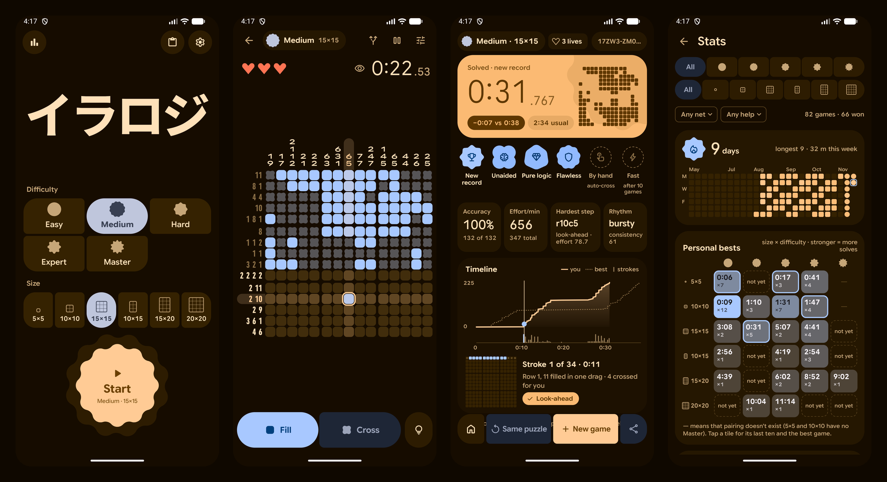

# Material Nonogram (イラロジ)

An offline nonogram (picross) for Android, built in Material 3 Expressive. No ads, no accounts, no network.

- Six sizes from 5×5 to 20×20 (zoom and pan on the biggest), five difficulties graded by the logic each puzzle needs
- Every puzzle generated on the phone, unique and solvable by logic, never a guess
- Slide across cells to fill or cross a whole run; shape-morphing tiles, rich haptics, a ms timer, graded hints
- Stats from a full move log: bests, streaks, a stroke-by-stroke replay, accuracy, effort
- Draw your own puzzle and share it as a short code; open codes or Simon Tatham's Pattern game IDs

**Download:** the APK is under [Releases](../../releases). Android 12+.

**Build:** `./gradlew assembleRelease` · tests: `./gradlew :app:testDebugUnitTest` · engine notes: [`docs/ENGINE.md`](docs/ENGINE.md)
